# Document extraction with an evaluation harness

Structured extraction from Indonesian (and some English) invoices, receipts, tax invoices (*faktur pajak*), e-commerce orders, utility
bills and hotel reservations, using a vision-language model, plus a harness that scores it, explains how it fails, compares two
versions and gates a regression. The extraction is one call per document; **the evaluation is the larger part of the repository.**

> **About the data in this repository.** The project was built and evaluated on 35 documents. Twelve of them were downloaded from the
> internet and their source and licence were never recorded, so they are **not published, and are not in the git history either**; that
> includes all 11 *faktur pajak* documents. What is here is **23 documents: 20 of my own and 3 synthetic invoices**, and every number in
> the sections below that cite `results/test-public` is measured on those 23. The reports in `docs/eval/`, `docs/demo/`, `docs/DEVLOG.md`
> and `results/original-dataset/` were written on the original 35 and cannot be reproduced from here; where they cite `results/test-g2` or
> `results/superseded/...`, read `results/original-dataset/...` (scorecards only, the per-document records were removed).

## The result in one screen

Test split: 16 documents (14 real, 2 constructed), 207 labeled scalar fields, 145 labeled line items, 6 of the 16 labeled **blind** (before any
model output existed). Model `deepseek/deepseek-v4-flash-vision-exp` through an OpenAI-compatible endpoint, reasoning effort `medium`. One run,
[results/test-public](results/test-public/), made on 2026-10-14 through the API: 2 documents were answered live and 14 from the response cache
(13 from earlier runs of the same model, prompt and settings, 1 from an attempt earlier the same day), so the sample is a mix of days.

| | all 16 | 14 real | 2 constructed |
| --- | --- | --- | --- |
| field accuracy (an abstention counts as an error) | **0.899** (186/207) | 0.884 (160/181) | 1.000 (26/26) |
| accuracy over the fields it answered / share answered | 0.916 / 0.981 | n/a | n/a |
| line items matched / missed / spurious | 135 / 10 / 48 | 33 / 10 / 48 | 102 / 0 / 0 |
| line items: F1 | 0.823 | **0.532** | 1.000 |
| cost per document at list price | $0.0100 ($0.0238 paid for the whole run) | | |

What to read before trusting those numbers:

- **The line-item headline is carried by the two constructed invoices.** They supply 102 of the 135 matched rows and every one is right, so the
  overall F1 of 0.823 says little about real documents: on the 14 real ones it is **0.532** (33 matched, 10 missed, 48 spurious). Nine of the 10 missed and 9 of the 48 spurious rows are in doc_027 and doc_020, the
  documents of the next point. For the rest, the analysis on the original test split found fees, vouchers and discounts returned as rows, a labeling question; I have not re-checked that on
  this subset. Quote the real column.
- **Number grounding has a known gap, not fixed in this run.** It reads whitespace-separated tokens ([grounding.py](src/docextract/validate/grounding.py)),
  so a quantity printed `x1` or `2x` never parses, the row's evidence is `evidence_not_grounded`, and the whole row is withheld even though the model had it right.
  In this run that is **9 rows: all 7 of doc_027 (so 0 of its 7 rows count) and 2 of doc_020**.
- **It is one sample of a noisy model.** Four identical-setting runs on the original dev split ranged 0.795 to 0.828 and 2 to 12 of 122 fields
  flipped between any two ([docs/eval/noise.md](docs/eval/noise.md)). A gap smaller than about 3 points between two runs is not a finding, and the latency of this
  run (p50 56 s) is two live calls: the original live run of 25 documents had p50 12.5 s, p95 58.5 s ([results/original-dataset/test-final](results/original-dataset/test-final/score/scorecard.md)).
- **On the original 25-document test split** (not reproducible here): 0.793 with the first labels, 0.845 after three wrong labels were corrected, 0.898 after the grounding
  fix for ambiguous numbers. The fix was chosen on dev before the test split was extracted ([docs/eval/grounding_fix.md](docs/eval/grounding_fix.md)). The three corrected
  labels are doc_032, doc_033 and doc_034, which are in this repository: they had been scored against the blind label of doc_016 because the manifest called them photos of it; a
  lineage audit flagged them, looking at the pages showed they were other documents, and they were relabeled (a draft by a different model, verified by hand; **not blind**) and logged in
  [ground_truth/CHANGELOG.md](ground_truth/CHANGELOG.md) ([docs/eval/hallucinations.md](docs/eval/hallucinations.md)).
- **Weak spots are real:** `vendor_name` 0.625, `document_number` 0.750, `document_date` 0.800, and the `bill` and `hotel_reservation` slices rest on one document each
  (per-slice tables in [results/test-public/score/scorecard.md](results/test-public/score/scorecard.md)).
- **Hallucination probe:** 0 of 19 erased fields were answered with a value (95% interval 0 to 17.6%), but on clean synthetic pages only; it
  says nothing about smudged or blurred text ([docs/eval/hallucination_probe.md](docs/eval/hallucination_probe.md)).

## Known limitations

- **The grounding gap above** is the next thing to fix (`x1`, `2x`, and any quantity glued to a letter). The result will then be re-run and compared with `test-public` by `scripts/compare.py`.
- **There is no *faktur pajak* document in the public dataset.** The extraction handles them (a *faktur* DPP is the subtotal, PPN the tax) and the measurements in `docs/eval/` include 11 of them, but nothing here lets you check that.
- **14 real test documents** cannot show a 2-point change, and 6 of the 16 labels are blind. Intervals are wide.
- **No redaction was applied.** `needs_redaction` is `n` for every document in [data/manifest.csv](data/manifest.csv) and [data/redactions.yaml](data/redactions.yaml) holds no box, so the 20 real documents are
  published as normalized scans and show everything the documents print (the labels include vendor tax ids and a shop phone number).
- **One annotator**, a model draft that a person verified for 13 of the 22 labels, and no agreement figure.

## Run it

Needs Docker and an API key for any OpenAI-compatible vision endpoint.

```bash
cp .env.example .env            # then fill LLM_API_KEY (model, endpoint and prices are already set; see the file)
docker compose up -d --wait     # the API on http://localhost:8000, left serving
curl localhost:8000/health      # model, prompt hash, settings, spend so far

docker compose run --rm eval    # the one-shot evaluation: the 16 test documents THROUGH that API
                                #   -> ./outputs/runs/<run_id>/{run.json, docs/, score/scorecard.md|json}
docker compose run --rm eval --doc doc_020 --run-id one    # any scripts/eval_api.py option: one document
```

The first `eval` on a clean clone makes real model calls: about **$0.16** for the test split at the prices in `.env.example` (`results/test-public` priced its 16 documents at $0.1606), and
`MAX_RUN_COST_USD` (0.50 there) stops a run that goes past it (the server's budget lasts as long as its process; `docker compose restart api`
resets it). Calls are cached by content (`outputs/cache`), so a repeat costs nothing.

Extract your own file (a PDF, or page images in order):

```bash
curl -F files=@invoice.pdf "localhost:8000/extract?compact=true"
curl -F files=@a.pdf -F files=@b.pdf localhost:8000/extract/batch      # one file = one document
```

**No key needed** (everything below is offline and deterministic):

```bash
uv sync
uv run pytest -q                                   # fast suite; add  -m "slow or not slow"  for everything (~3,000 tests)
uv run python scripts/check_results.py             # re-scores the committed run; must reproduce it byte for byte
uv run python scripts/analyze_failures.py results/test-public           # how it fails, by kind
```

`scripts/compare.py` (the regression gate) needs two runs that both have per-document records. The original pair was only kept as scorecards, so there is none to compare yet;
the first pair will be `test-public` and the run after the grounding fix.

`uv` is not on PATH on every machine; `python -m uv ...` is the same command. On Windows keep the checkout path short (a few dozen characters):
Numba writes cache files deep inside `.venv`, and the image-degradation tests fail once a path passes 260 characters. Text files are LF in every checkout
([.gitattributes](.gitattributes)), because the scorecards hash the label and manifest files as bytes.

## What was built

```mermaid
flowchart LR
  RAW["data/private/raw<br/>(gitignored originals)"] --> ING["ingest: upright, render PDF 200 dpi,<br/>size cap, REDACT, encode"]
  ING --> PAGES["data/pages<br/>redacted pages + ingest.json"]
  UP["HTTP upload<br/>/extract, /extract/batch"] --> EX
  PAGES --> EX["ONE call per document:<br/>all pages in order"]
  EX --> PRE["parse JSON, normalize numbers and dates,<br/>evidence contract"]
  PRE -- "invalid: ask again (bounded)" --> EX
  PRE --> VAL["validate: row arithmetic, reconciliation,<br/>field checks, evidence grounding,<br/>confidence caps, abstention"]
  VAL --> REC["record: raw text, parsed,<br/>validated, tokens, cost, latency"]
  REC --> SCORE["score vs ground truth:<br/>comparators, row matching, error taxonomy"]
  SCORE --> CARD["scorecard + run manifest"]
  CARD --> CMP["compare two runs:<br/>McNemar + bootstrap, exit code"]
```



### Schema and why

13 scalar fields (vendor name, address, tax id; buyer; document number; document and due date; currency; payment method; subtotal, tax,
discount, total) and line items (description, quantity, unit price, amount). Every field carries **value, confidence, a verbatim evidence
quote, the page, a status and reasons** ([src/docextract/extract/schema.py](src/docextract/extract/schema.py)). The status is
three-way, which is what makes "no hallucination" testable:

- `extracted`: the document prints it (value required, quote required);
- `absent`: the document does not state it (value null; the confidence is the certainty of absence);
- `abstained`: it may be there but I am not confident (value null; a reason is required).

Money is `Decimal` end to end. Fields are as the labeling protocol defines them ([ground_truth/LABELING.md](ground_truth/LABELING.md)):
a *faktur* DPP is the subtotal, PPN the tax, the *nomor seri faktur* the document number.

### Why one call and not an agent

A document is at most a few pages here (29 pages over the 23 published documents, 3 at most; the bound is `LLM_MAX_PAGES`, 15) and the fields that need
reasoning across sections (a total on the last page, a number repeated in each continuation header, line items that run over pages) are
easiest when the model sees every page at once. An agent that routes pages or calls tools would add latency, cost and its own failure
modes for no gain I could point to. **I did not run an agentic baseline, so this is a design argument, not a measurement**; the bounded
repair loop (re-ask once when the output is not valid) is the only iteration.

### The rules that keep it honest

- **The normalizer never guesses** ([src/docextract/normalize.py](src/docextract/normalize.py)): `1.250` is thousands in an IDR context, a
  decimal in a USD context and *ambiguous* with no context; `05/03/2024` is ambiguous unless a day is above 12. Ambiguity is reported,
  never resolved quietly.
- **Business rules live outside the schema** ([src/docextract/validate/](src/docextract/validate/)), and they return copies: the model's raw
  answer and the validated answer are both kept in every record, so what the model said and what the guards concluded can always be compared.
- **Grounding is self-consistency:** an extracted value must be traceable in its own evidence quote. It cannot catch a quote and a value
  invented together (there is no OCR text layer to check against).
- **Confidence** is the model's score, lowered by caps for what the validators found, never raised. A value its own evidence contradicts
  is abstained whatever its confidence. The caps and the abstention threshold are **placeholders**: the calibration analysis found the capped
  confidence worse calibrated than the model's own (ECE 0.116 against 0.071) and the 0.3 threshold never fires
  ([docs/eval/calibration.md](docs/eval/calibration.md)). In practice abstention today is the grounding rule plus the model abstaining itself.
- **A blind document is never extracted until its label exists**: the runner refuses it with zero requests.

## The dataset

**Published: 23 documents, 29 pages: 20 are my own documents or scans, 3 are synthetic** (constructed multi-page rupiah invoices with 30 to 60 rows, generated by
[src/evalkit/construct.py](src/evalkit/construct.py)). By capture: 15 phone photos, 4 born-digital, 1 screen capture, 3 constructed. By type: 13
receipts, 4 e-commerce, 3 invoices, 2 hotel reservations, 1 bill, **0 fakturs**. Split by content group, never straddling:
**7 dev (used to build and tune) and 16 test.** One test document (doc_034) shares the label of another photo of the same document (doc_032) through `gt_from`.

The original dataset had 35 documents, 45 pages, 10 dev and 25 test, including 12 downloaded from the internet (11 *faktur*, 1 invoice) whose source URLs the manifest never recorded.
Those 12 and their labels, drafts and per-document results were removed from the tree and from every commit before this repository was made public
(each removal is a line in [ground_truth/CHANGELOG.md](ground_truth/CHANGELOG.md)); the specification of that cleanup is [docs/milestones/P1.md](docs/milestones/P1.md).

Originals live in `data/private/` (gitignored, never committed) and the committed pages in `data/pages/` are the normalized ones. Ingestion has a redaction gate (a document
whose `needs_redaction` is undecided, or inconsistent with its boxes, is refused), but every published document was decided `n`, so `data/redactions.yaml` holds no box: see Known limitations.

**Ground truth** ([ground_truth/](ground_truth/), protocol in [LABELING.md](ground_truth/LABELING.md), every change logged in
[CHANGELOG.md](ground_truth/CHANGELOG.md)): 13 labels started from a draft by a different model (Claude Haiku, never the extractor) and a person verified **every field** in a labeling app that refuses to save
while anything is undecided; **6 test documents were labeled blind**, from the page alone, before any model output existed for them; the 3 constructed
documents have generated labels (and 1 copy borrows a label). That is 22 label files for 23 documents. Each label records how it was made (`label_mode`, `labeled_at`); the scorecard records a hash of the
labels and of the dataset, so two scorecards are comparable only if those match.

## Evaluation

[src/evalkit/](src/evalkit/) is hand-written (no framework): type-aware comparators (normalized strings, fuzzy names, numeric tolerance, dates),
line items paired by a Hungarian assignment, and an 11-class error taxonomy (numeric, date, string, near-miss name, hallucinated value,
missing value, abstained on a value, abstained on an absent field, row missed, row spurious, no prediction).

- **Two numbers, not one:** the headline `accuracy` counts an abstention or a missing answer as an error; `selective accuracy` and `coverage`
  report what it answered and how much of it. Only the validated output is scored, never the raw one.
- **Scorecard** (markdown + JSON, per-document results, slices by type and capture, cost and latency p50/p95) and a **run manifest**: git SHA,
  prompt hash, model, settings, label hash, dataset hash. `uv run python scripts/score.py outputs/runs/<id>`.
- **Failure analysis** ([docs/eval/failure_analysis.md](docs/eval/failure_analysis.md)) scores every field twice, as returned and as the model said
  it, which separates "the model was wrong" from "the guard withheld a correct value". That is how the grounding flaw was found: on dev, 11 of
  14 abstentions had withheld a *correct* value (a quote printing `208,179` with no currency). The fix is [one validator rule](docs/eval/grounding_fix.md).
- **Catching a regression** ([scripts/compare.py](scripts/compare.py)): the two runs are re-scored against the labels as they are now and paired field by
  field; a regression needs **both** an exact one-sided McNemar p <= 0.05 **and** an accuracy drop >= 2 points; exit code 1 means regressed. Demonstrated on a
  deliberately degraded prompt (subtotal/total swapped, amounts divided by 1000, "never leave a field empty"): caught on dev, -9.8 points, p = 0.0113
  ([docs/demo/regression_demo.md](docs/demo/regression_demo.md)). The gate's power is limited by the sample: about 130 labeled fields catch a 5-point
  drop 78% of the time, about 400 catch a 2-point drop 90% of the time.
- **Noise, calibration, hallucinations, the probe:** [noise](docs/eval/noise.md), [calibration](docs/eval/calibration.md) (reliability and
  risk-coverage curves), [what the hallucinated values are](docs/eval/hallucinations.md), and [a probe set with fields digitally erased](docs/eval/hallucination_probe.md)
  (copies of the constructed invoices with a value painted out or the last page dropped, where the expected answer is `absent` or `abstained`).

## Production

- **API** ([src/docextract/api/](src/docextract/api/)): FastAPI, `/extract` (one document from uploaded pages), `/extract/batch` (one file per document),
  one process-wide semaphore bounds documents in flight, optional bearer token, upload limits, one JSON log line per request (tokens, cost, latency, never content).
- **Cost and latency are visible**: every record has its tokens, the cost paid and the cost at list price, and the latency; the scorecard rolls them up by
  slice. Reasoning tokens are costed per response, never double counted. `MAX_RUN_COST_USD` stops a run cleanly and the runners exit non-zero.
- **Resilience:** retry with backoff on provider errors, a bounded repair loop on invalid output, a content-hash response cache (a replay costs 0 and re-runs
  the validators, so a validator change never serves a stale result), refused-before-any-request for a document over the page limit.
- **The optimization, measured** ([docs/demo/m8_sweep.md](docs/demo/m8_sweep.md)): image resolution and reasoning effort varied one at a time on dev with a selection
  rule fixed in code beforehand. `effort=low` cost 23% less and ran 21% faster for -0.8 accuracy points, **inside the noise**; `effort=off` was 2.4x cheaper and
  2.5x faster for -2.5 points, outside the 2-point tolerance. The rule picked `low`; I kept `medium` anyway (recorded in the same file). Two larger gains were not a sweep
  point: moving the extractor to a faster model (p50 122 s to 16.6 s at the same dev accuracy) and the cache.

## Which model, and what happened to Gemini and GLM

The provider is configuration (`LLM_BASE_URL`, `LLM_MODEL`, prices), so changing it never touched the code; it did change what could be compared. Three models were the
extractor in turn, and **every number in this README comes from the last one**.

| order | model and endpoint | what happened | why it was left |
| --- | --- | --- | --- |
| 1 | **Gemini** (2.5, then 3.5 / 3.6 Flash) on the Google AI Studio free tier, the brief's suggestion | used for the first live checks and the degraded-prompt demo. When it answered it did well: strict `json_schema` accepted, and on the three constructed invoices every row and total matched the labels (45, 57 and 33 rows) | `gemini-2.5-flash` answered 404 ("no longer available to new users"); 3.6 to 3.8 answered 503 "high demand" through several retries; 3.5 needed about 14 attempts and then hit HTTP 429, because the free tier allows about **20 requests a day per model and counts every 503 and retry**. The dev baseline run on it (`gemini-3.7-flash`) ended with **9 of 10 documents failed** (503 and 429), nothing usable |
| 2 | **GLM 5.3 Flash** through Command Code (an OpenAI-compatible provider), $0.15 / $0.50 per million tokens | the first complete dev baseline: 10 of 10 documents, accuracy 0.820 | **too slow for a synchronous API**: median 122.5 s and p95 586.4 s per document |
| 3 | **DeepSeek V4 Flash Vision (exp)** through Command Code | the same 10 documents: accuracy 0.811 (the same within noise), median **16.6 s**, p95 81.4 s, $0.0047 per document in that sweep | **kept**: every result in this repository is from it, with `json_object` output and reasoning effort `medium` |

Source for rows 2 and 3: [docs/demo/m8_sweep.md](docs/demo/m8_sweep.md) ("Model context"); the provider history is in [docs/DEVLOG.md](docs/DEVLOG.md) (M1, M3, M6, M8).

What follows from it, stated plainly:

- **There is no Gemini accuracy on this dataset.** It never completed a dev run, so no claim here compares Gemini with DeepSeek on quality. The dev comparison of GLM and DeepSeek is one run of 10
  documents each, so "the same accuracy" means "not distinguishable at this sample size".
- **The switch was forced by availability and latency, not chosen on accuracy.** A free tier with a daily request cap cannot carry an evaluation (a 10-document run with retries can exhaust it),
  and a 2-minute median cannot sit behind an API.
- **Changing the model silently would have corrupted a comparison, and once nearly did.** The first regression-gate comparison used a baseline made before `.env` moved to another Gemini model and
  lost its cost cap; `compare.py` prints what differs between the two runs (model, prompt hash, settings), which exposed it, and the baseline was re-run
  ([docs/DEVLOG.md](docs/DEVLOG.md), M6). The sweep baseline is a fresh DeepSeek run for the same reason.
- **Prices are the weak number.** The sweep was costed at a third-party tracker's $0.22 / $0.66 per million tokens; the provider's own page lists $0.15 / $0.60 off-peak and $0.30 / $1.20 at peak.
  Reported costs here use the **peak** list prices, so they are upper bounds.
- The pre-labeler is a separate model on purpose (Claude Haiku, through Anthropic's OpenAI-compatible endpoint, with the schema in the prompt because that endpoint rejects `json_object`),
  and the code refuses to use the extractor's own model to draft labels.

## Key trade-offs

| decision | for | against |
| --- | --- | --- |
| VLM on page images, no OCR | one component, handles photos and layouts | no text layer, so grounding cannot check a quote against the page |
| one call per document | simple, all pages in context | a long document must fit the limit; no per-page retry |
| a cheap, fast model | $0.008 per document, p50 12.5 s | more field noise than a larger model would likely have (not measured) |
| validators outside the schema, raw kept | inspectable, replayable offline | two outputs per record to understand |
| abstain on contradiction, not on low confidence | the confidence is not calibrated enough to threshold | few abstentions, and the model's confident hallucinations pass |
| labels drafted by a second model, verified by a person | 32 label files in three days (22 published) | the draft can anchor the verifier; hence the blind labels (10 originally, 6 published) |
| small dataset, real and messy | real layouts, own scans | wide intervals; a 16-document test split cannot show a 2-point change |

## Agentic development

**How it was built.** The code was written with Claude Code (Sonnet 5.5 on most commits, Opus 5.5 on some) under a process I set; a few commits also
carry a Command Code agent as co-author. The documents, the redaction boxes, all the hand labels (the blind ones included) and the decisions
between options (which extractor, the effort setting, what to build next) are mine; the agent wrote and tested the code against specs I approved.

- [CLAUDE.md](CLAUDE.md) is the project's rulebook the agent reads first: privacy by location (never read a real page while building tooling), "core logic hand-written, no
  LangChain", ground-truth rules, the exact commands for this machine, and the **milestone procedure**: one milestone per session, a spec
  (goal, scope, files, files not to touch, runnable acceptance criteria, risks) **committed before any code** ([docs/milestones/](docs/milestones/)), a plan I approve, a development
  log entry at the end ([docs/DEVLOG.md](docs/DEVLOG.md)). Costly commands are marked and run only after approval.
- **The extension I built and actually used: a mutation-testing tool and skill** ([tools/mutation_check.py](tools/mutation_check.py),
  [.claude/skills/mutation-check/SKILL.md](.claude/skills/mutation-check/SKILL.md)). After writing logic or its tests the agent breaks the code on purpose, in an **isolated copy**,
  after a **green baseline**, and a mutant that no test notices is a missing test. It ran on every milestone after it existed (mutant files in [tests/mutants/](tests/mutants/)) and the earlier
  milestones' passes are in the log. What it found: vacuous assertions (`assert ... or True`), a test world that could not tell a weighted mean from a plain one, a test
  skipped because it was marked slow, a quadratic regular expression that hung the secret scanner, and, in this very tool, a harness that reports every mutant "killed" when it cannot run
  the tests (hence the green baseline). One flaky test of the tool exposed a stale-bytecode race that could report a false kill (a mutant of the same size written in the same second ran the previous mutation); it is reproduced by a deterministic test and fixed.
- **A guard hook** ([.claude/hooks/pre_commit_secret_scan.py](.claude/hooks/pre_commit_secret_scan.py), wired in [.claude/settings.json](.claude/settings.json), scanner in
  [tools/secret_scan.py](tools/secret_scan.py)): a Claude Code `PreToolUse` hook that scans what a `git commit` would add and blocks it on a key-shaped value. It exists because a real key was
  nearly pasted into `.env.example`. It is tested with fake keys; the log does not show it blocking anything real.

**What the agent got wrong, and what caught it** (all in the development log): a commit made with one failing test because a pipe masked the exit code; a "model effect" that was
run-to-run noise (withdrawn); a spec that predicted a degraded prompt would pass every validator (it did not); a live call that showed a provider's endpoint rejects the structured mode
the code assumed; scripts with backslashes silently corrupted by shell heredocs (a recurring Windows trap, now a rule in CLAUDE.md); and a claim that uploaded pages are
byte-identical to ingested ones, true for PNG and false for JPEG, found only when the eval client uploaded stored pages.

## Milestones: what was reached and what was not

Checked against the "definition of done" of each line of [docs/ROADMAP.md](docs/ROADMAP.md). Each milestone has its spec
in [docs/milestones/](docs/milestones/) and its outcome in [docs/DEVLOG.md](docs/DEVLOG.md).

**Must have**

| | status | what the definition asked, and what is true |
| --- | --- | --- |
| M1 scaffolding | reached | tests pass; a live smoke call returned JSON from the provider. |
| M2 dataset and ground truth | **partly** | Asked for **40 documents, all labeled blind**. There were **35** (32 real, 3 synthetic), all labeled, with a label hash recorded; **23 are published** (20 real, 3 synthetic), see "About the data". Why 35: three candidate documents were dropped after the labeling rules were written (two invoices on one page, a 20-page bundle of many companies, a copy), and no more were collected in the three days. Why not all blind: only the real test documents were labeled blind (**10** originally, **6** published); 21 labels started from a model draft that a person verified field by field (13 published), and doc_032 and doc_033 were relabeled after the extractor had already seen them (logged in [ground_truth/CHANGELOG.md](ground_truth/CHANGELOG.md)). Blind labeling costs a person's time per document, so it was spent on the test split. |
| M3 extraction v1 | reached | ran on every dev document with no crash; malformed output is repaired by a bounded re-ask. |
| M4 validators, confidence, abstention | reached as specified, **weak in effect** | every field carries value, confidence, evidence, status and reasons, and the validators run. The confidence caps and the abstention threshold are placeholders: calibration found them worse than the model's own confidence, and the threshold never fires (see Evaluation). |
| M5 eval harness | reached | scorecard (markdown + JSON), per-document results, and a run manifest with git SHA, prompt hash, model, settings, label hash and dataset hash. |
| M6 regression comparison | reached | demonstrated on a deliberately degraded prompt, caught (exit 1) and documented. |
| M7 API, batching, cost/latency | reached | the scorecard shows cost per document and latency p50/p95, overall and by slice (latency is n/a for a run answered from the cache, so the live-run figures are in `results/original-dataset/test-final`). |
| M8 one optimization, measured | reached, with a **deviation** | a before/after table is in the scorecard. "Token budget" is the reasoning effort, not an output-token cap (a cap breaks a reasoning model's JSON). The selection rule picked `effort=low` and I kept `medium`; the reason is recorded, and the difference is inside the noise. |
| M9 Docker | reached, one **caveat** | `docker compose up` serves the API, `docker compose run --rm eval` goes through it, and a real run's artifacts are committed (`results/test-public`; the Docker run of the original 25 documents is kept as a scorecard only). The image was built and run from the committed tree, not rebuilt from a fresh clone on another machine. |
| M10 agentic note and README | reached | this file. |

**Should have**

| | status | why |
| --- | --- | --- |
| S1 calibration | **partly** | reliability diagram and risk-coverage curve: done, on dev. The threshold was chosen on dev but **not reported on test**: the test labels arrived after the analysis and it was not rerun on them. |
| S2 self-consistency | **not done** | not attempted: time went to the grounding fix, the Docker eval and the probe, which had a larger measured effect. |
| S3 model cascade | **not done** | same: not attempted. |
| S4 hallucination probe | reached, with a limit | 9 probes + 3 controls, 0 of 19 erased fields answered; clean synthetic pages only, so it says nothing about smudged text. |
| S5 local model run | **not done** | the available GPU (4 GB) cannot serve a useful vision model; no local run was made. |
| S6 CI | reached | GitHub Actions runs the secret scan over the whole history, `ruff`, the full test suite and the offline re-score of the committed predictions (no API key needed); it passed on the first push. It has no Docker job (the runner is Windows). |
| S7 robustness slice | **not done** | the degradation tooling exists and is tested ([src/docextract/ingest/degrade.py](src/docextract/ingest/degrade.py)), but no degraded variant is in the dataset and no robustness run was made: time. |

**Nice to have**

| | status | why |
| --- | --- | --- |
| N1 OCR + LLM ablation | not done | not attempted. |
| N2 review UI | not done | the labeling app exists, but there is no page that lists abstained fields for review. |
| N3 cache and idempotent batch jobs | **partly** | the content-hash response cache is done; batch jobs are synchronous, not idempotent jobs. |
| N4 metrics endpoint | not done | there is a per-request JSON call log, no Prometheus endpoint. |
| N5 second annotator | not done | one annotator; the blind labels reduce the anchoring risk but give no agreement figure. |
| N6 field-level re-ask on a crop | not done | not attempted. |

## What I would do with more time

1. **A smudge probe**: the probe above paints a value out; the real misses are text that is *there but unreadable*. Blur or lower the contrast of a value and measure again, then probe real
   documents with boxes measured in the labeling app.
2. **Make confidence mean something**: the capped confidence is worse calibrated than the model's own; try a second sample at temperature > 0 (disagreement lowers confidence) and a
   cheap-model-first cascade, and report cost against accuracy.
3. **More data and a second annotator**: 16 test documents (25 originally) cannot show a 2-point change; a second pass on 10 documents would give inter-annotator agreement for the labels.
4. **A decision on row definitions**: fees, vouchers, discounts and zero-amount items are returned as line items; whether they are line items is a labeling policy, and the 15 row-cell cases among the 17
   `hallucinated_value` errors on the original test split are mostly that question.
5. **Other models**: a local run (the author's 4 GB GPU cannot serve a useful vision model) and an OCR + LLM ablation, compared head to head with the same gate.
6. **Operations**: CI exists ([.github/workflows/ci.yml](.github/workflows/ci.yml): secret scan, lint, the suite, the offline re-score) and passes on GitHub, but has no Docker job (the runner is
   Windows); async batch jobs and a metrics endpoint.

## Where to start reading

| to see | open |
| --- | --- |
| the extraction call and its repair loop | [src/docextract/extract/extractor.py](src/docextract/extract/extractor.py), [prompt.py](src/docextract/extract/prompt.py), [providers/openai_compat.py](src/docextract/providers/openai_compat.py) |
| the validators, grounding, abstention | [src/docextract/validate/](src/docextract/validate/), [src/docextract/confidence/](src/docextract/confidence/) |
| scoring, row matching, the error taxonomy | [src/evalkit/metrics.py](src/evalkit/metrics.py), [matching.py](src/evalkit/matching.py), [taxonomy.py](src/evalkit/taxonomy.py) |
| the regression gate | [src/evalkit/compare.py](src/evalkit/compare.py), [scripts/compare.py](scripts/compare.py) |
| the API and the eval client | [src/docextract/api/app.py](src/docextract/api/app.py), [scripts/eval_api.py](scripts/eval_api.py) |
| how it was decided, milestone by milestone | [docs/DEVLOG.md](docs/DEVLOG.md), [docs/milestones/](docs/milestones/) |
| the committed runs and how they reproduce | [results/README.md](results/README.md) |

## Configuration

Everything about the provider is environment: `LLM_BASE_URL`, `LLM_API_KEY`, `LLM_MODEL`, the two per-million-token prices (for cost), and optional structured-output mode, reasoning
effort, retries, cache and cost cap. [.env.example](.env.example) lists all of them with the alternatives that were tried (Gemini, GLM, a local Ollama). Nothing is hardcoded and `.env`
is gitignored; a scanner refuses a commit that adds a key.

## License

The code is MIT-licensed ([LICENSE](LICENSE)). The page images under `data/pages/` and the labels and results derived from them are my own documents and synthetic invoices, shared so the
evaluation can be reproduced; the MIT licence is for the code, and I grant no other rights over those documents.
