# Document extraction with an evaluation harness

Structured extraction from Indonesian (and some English) invoices, receipts, tax invoices (*faktur pajak*), e-commerce orders, utility
bills and hotel reservations, using a vision-language model, plus a harness that scores it, explains how it fails, compares two
versions and gates a regression. The extraction is one call per document; **the evaluation is the larger part of the repository.**

## The result in one screen

Test split: 25 documents, 323 labeled scalar fields, 184 labeled line items, 10 of the 25 labeled **blind** (before any model output
existed). Model `deepseek/deepseek-v4-flash-vision-exp` through an OpenAI-compatible endpoint, reasoning effort `medium`.

| | first real run (`results/test-final`) | after one validator fix (`results/test-g1`) |
| --- | --- | --- |
| field accuracy (an abstention counts as an error) | 0.793 | **0.845** |
| accuracy over the fields it answered / share answered | 0.859 / 0.923 | 0.867 / 0.975 |
| line items: F1 / cell accuracy | 0.777 / 0.944 | 0.817 / 0.945 |
| cost per document at list price | $0.0080 | same answers, replayed from the cache |
| latency, one live run of 25 | p50 12.5 s, p95 58.5 s | n/a (cached) |

What to read before trusting those numbers:

- **They are one sample of a noisy model.** Four identical-setting runs on the dev split ranged 0.795 to 0.828 and 2 to 12 of 122 fields
  flipped between any two ([docs/eval/noise.md](docs/eval/noise.md)). A gap smaller than about 3 points between two runs is not a finding.
- **The fix was chosen on dev, before the test split was ever extracted**, and predicted for test before the replay: 17 fields restored,
  0 regressed, exactly as predicted ([docs/eval/grounding_fix.md](docs/eval/grounding_fix.md)). The two columns have the same raw model
  answers (all 25 calls were cache hits), so the difference is the validators alone.
- **Three test documents may carry the wrong label.** doc_032, doc_033 and doc_034 are scored against the blind label of doc_016 (an
  electricity-token bill), but the model reads them as three different shop receipts. A tool flags them and a person has to look at the
  pages; if they are different documents, accuracy on the other 22 is 0.905 and the scalar hallucination rate falls from 10.3% to 2.2%
  ([docs/eval/hallucinations.md](docs/eval/hallucinations.md)). **This is open at the time of writing; the committed numbers use the labels as they are.**
- **Weak spots are real:** phone photos 0.768, the `bill` document type 0.519, `vendor_name` 0.640, `subtotal` 0.625
  (per-slice tables in [results/test-g1/score/scorecard.md](results/test-g1/score/scorecard.md)).
- **Hallucination probe:** 0 of 19 erased fields were answered with a value (95% interval 0 to 17.6%), but on clean synthetic pages only; it
  says nothing about smudged or blurred text ([docs/eval/hallucination_probe.md](docs/eval/hallucination_probe.md)).

## Run it

Needs Docker and an API key for any OpenAI-compatible vision endpoint.

```bash
cp .env.example .env            # then fill LLM_API_KEY (model, endpoint and prices are already set; see the file)
docker compose up -d --wait     # the API on http://localhost:8000, left serving
curl localhost:8000/health      # model, prompt hash, settings, spend so far

docker compose run --rm eval    # the one-shot evaluation: the 25 test documents THROUGH that API
                                #   -> ./outputs/runs/<run_id>/{run.json, docs/, score/scorecard.md|json}
docker compose run --rm eval --doc doc_020 --run-id one    # any scripts/eval_api.py option: one document
```

The first `eval` on a clean clone makes real model calls: about **$0.20** for the test split at the prices in `.env.example`, and
`MAX_RUN_COST_USD` (0.50 there) stops a run that goes past it (the server's budget lasts as long as its process; `docker compose restart api`
resets it). Calls are cached by content (`outputs/cache`), so a repeat costs nothing.

Extract your own file (a PDF, or page images in order):

```bash
curl -F files=@invoice.pdf "localhost:8000/extract?compact=true"
curl -F files=@a.pdf -F files=@b.pdf localhost:8000/extract/batch      # one file = one document
```

**No key needed** (everything below is offline and deterministic):

```bash
uv sync
uv run pytest -q                                   # fast suite; add  -m "slow or not slow"  for everything (~3,000 tests)
uv run python scripts/check_results.py             # re-scores the committed runs; must reproduce them byte for byte
uv run python scripts/compare.py results/test-final results/test-g1     # the regression gate, on the two committed runs
uv run python scripts/analyze_failures.py results/test-g1               # how it fails, by kind
```

`uv` is not on PATH on every machine; `python -m uv ...` is the same command. On Windows keep the checkout path short (a few dozen characters):
Numba writes cache files deep inside `.venv`, and the image-degradation tests fail once a path passes 260 characters. Text files are LF in every checkout
([.gitattributes](.gitattributes)), because the scorecards hash the label and manifest files as bytes.

## What was built

```mermaid
flowchart LR
  RAW["data/private/raw<br/>(gitignored originals)"] --> ING["ingest: upright, render PDF 200 dpi,<br/>size cap, REDACT, encode"]
  ING --> PAGES["data/pages<br/>redacted pages + ingest.json"]
  UP["HTTP upload<br/>/extract, /extract/batch"] --> EX
  PAGES --> EX["ONE call per document:<br/>all pages in order"]
  EX --> PRE["parse JSON, normalize numbers and dates,<br/>evidence contract"]
  PRE -- "invalid: ask again (bounded)" --> EX
  PRE --> VAL["validate: row arithmetic, reconciliation,<br/>field checks, evidence grounding,<br/>confidence caps, abstention"]
  VAL --> REC["record: raw text, parsed,<br/>validated, tokens, cost, latency"]
  REC --> SCORE["score vs ground truth:<br/>comparators, row matching, error taxonomy"]
  SCORE --> CARD["scorecard + run manifest"]
  CARD --> CMP["compare two runs:<br/>McNemar + bootstrap, exit code"]
```



### Schema and why

13 scalar fields (vendor name, address, tax id; buyer; document number; document and due date; currency; payment method; subtotal, tax,
discount, total) and line items (description, quantity, unit price, amount). Every field carries **value, confidence, a verbatim evidence
quote, the page, a status and reasons** ([src/docextract/extract/schema.py](src/docextract/extract/schema.py)). The status is
three-way, which is what makes "no hallucination" testable:

- `extracted`: the document prints it (value required, quote required);
- `absent`: the document does not state it (value null; the confidence is the certainty of absence);
- `abstained`: it may be there but I am not confident (value null; a reason is required).

Money is `Decimal` end to end. Fields are as the labeling protocol defines them ([ground_truth/LABELING.md](ground_truth/LABELING.md)):
a *faktur* DPP is the subtotal, PPN the tax, the *nomor seri faktur* the document number.

### Why one call and not an agent

A document is at most a few pages here (45 pages over 35 documents, 3 at most; the bound is `LLM_MAX_PAGES`, 15) and the fields that need
reasoning across sections (a total on the last page, a number repeated in each continuation header, line items that run over pages) are
easiest when the model sees every page at once. An agent that routes pages or calls tools would add latency, cost and its own failure
modes for no gain I could point to. **I did not run an agentic baseline, so this is a design argument, not a measurement**; the bounded
repair loop (re-ask once when the output is not valid) is the only iteration.

### The rules that keep it honest

- **The normalizer never guesses** ([src/docextract/normalize.py](src/docextract/normalize.py)): `1.250` is thousands in an IDR context, a
  decimal in a USD context and *ambiguous* with no context; `05/03/2024` is ambiguous unless a day is above 12. Ambiguity is reported,
  never resolved quietly.
- **Business rules live outside the schema** ([src/docextract/validate/](src/docextract/validate/)), and they return copies: the model's raw
  answer and the validated answer are both kept in every record, so what the model said and what the guards concluded can always be compared.
- **Grounding is self-consistency:** an extracted value must be traceable in its own evidence quote. It cannot catch a quote and a value
  invented together (there is no OCR text layer to check against).
- **Confidence** is the model's score, lowered by caps for what the validators found, never raised. A value its own evidence contradicts
  is abstained whatever its confidence. The caps and the abstention threshold are **placeholders**: the calibration analysis found the capped
  confidence worse calibrated than the model's own (ECE 0.116 against 0.071) and the 0.3 threshold never fires
  ([docs/eval/calibration.md](docs/eval/calibration.md)). In practice abstention today is the grounding rule plus the model abstaining itself.
- **A blind document is never extracted until its label exists**: the runner refuses it with zero requests.

## The dataset

35 documents, 45 pages: **20 are my own documents or scans, 12 were downloaded from the internet (the manifest does not record their
source URLs: a gap), 3 are synthetic** (constructed multi-page rupiah invoices with 30 to 60 rows, generated by
[src/evalkit/construct.py](src/evalkit/construct.py)). By capture: 15 phone photos, 14 born-digital, 3 screen captures, 3 constructed. By type: 12
receipts, 11 fakturs, 4 bills, 4 invoices, 2 e-commerce, 2 hotel reservations. Split by content group, never straddling:
**10 dev (used to build and tune) and 25 test.** Three test documents share another document's label through `gt_from` (see above).

Privacy by location: originals live in `data/private/` (gitignored, never committed); only normalized, **redacted** pages are committed
(`data/pages/`, boxes in `data/redactions.yaml`). Redaction is a hard gate in ingestion: an undecided or inconsistent document is refused.

**Ground truth** ([ground_truth/](ground_truth/), protocol in [LABELING.md](ground_truth/LABELING.md), every change logged in
[CHANGELOG.md](ground_truth/CHANGELOG.md)): 19 labels started from a draft by a different model (Claude Haiku, never the extractor) and a person verified **every field** in a labeling app that refuses to save
while anything is undecided; **10 test documents were labeled blind**, from the page alone, before any model output existed for them; the 3 constructed
documents have generated labels (and 3 copies borrow a label). Each label records how it was made (`label_mode`, `labeled_at`); the scorecard records a hash of the
labels and of the dataset, so two scorecards are comparable only if those match.

## Evaluation

[src/evalkit/](src/evalkit/) is hand-written (no framework): type-aware comparators (normalized strings, fuzzy names, numeric tolerance, dates),
line items paired by a Hungarian assignment, and an 11-class error taxonomy (numeric, date, string, near-miss name, hallucinated value,
missing value, abstained on a value, abstained on an absent field, row missed, row spurious, no prediction).

- **Two numbers, not one:** the headline `accuracy` counts an abstention or a missing answer as an error; `selective accuracy` and `coverage`
  report what it answered and how much of it. Only the validated output is scored, never the raw one.
- **Scorecard** (markdown + JSON, per-document results, slices by type and capture, cost and latency p50/p95) and a **run manifest**: git SHA,
  prompt hash, model, settings, label hash, dataset hash. `uv run python scripts/score.py outputs/runs/<id>`.
- **Failure analysis** ([docs/eval/failure_analysis.md](docs/eval/failure_analysis.md)) scores every field twice, as returned and as the model said
  it, which separates "the model was wrong" from "the guard withheld a correct value". That is how the grounding flaw was found: on dev, 11 of
  14 abstentions had withheld a *correct* value (a quote printing `208,179` with no currency). The fix is [one validator rule](docs/eval/grounding_fix.md).
- **Catching a regression** ([scripts/compare.py](scripts/compare.py)): the two runs are re-scored against the labels as they are now and paired field by
  field; a regression needs **both** an exact one-sided McNemar p <= 0.05 **and** an accuracy drop >= 2 points; exit code 1 means regressed. Demonstrated on a
  deliberately degraded prompt (subtotal/total swapped, amounts divided by 1000, "never leave a field empty"): caught on dev, -9.8 points, p = 0.0113
  ([docs/demo/regression_demo.md](docs/demo/regression_demo.md)). The gate's power is limited by the sample: about 130 labeled fields catch a 5-point
  drop 78% of the time, about 400 catch a 2-point drop 90% of the time.
- **Noise, calibration, hallucinations, the probe:** [noise](docs/eval/noise.md), [calibration](docs/eval/calibration.md) (reliability and
  risk-coverage curves), [what the hallucinated values are](docs/eval/hallucinations.md), and [a probe set with fields digitally erased](docs/eval/hallucination_probe.md)
  (copies of the constructed invoices with a value painted out or the last page dropped, where the expected answer is `absent` or `abstained`).

## Production

- **API** ([src/docextract/api/](src/docextract/api/)): FastAPI, `/extract` (one document from uploaded pages), `/extract/batch` (one file per document),
  one process-wide semaphore bounds documents in flight, optional bearer token, upload limits, one JSON log line per request (tokens, cost, latency, never content).
- **Cost and latency are visible**: every record has its tokens, the cost paid and the cost at list price, and the latency; the scorecard rolls them up by
  slice. Reasoning tokens are costed per response, never double counted. `MAX_RUN_COST_USD` stops a run cleanly and the runners exit non-zero.
- **Resilience:** retry with backoff on provider errors, a bounded repair loop on invalid output, a content-hash response cache (a replay costs 0 and re-runs
  the validators, so a validator change never serves a stale result), refused-before-any-request for a document over the page limit.
- **The optimization, measured** ([docs/demo/m8_sweep.md](docs/demo/m8_sweep.md)): image resolution and reasoning effort varied one at a time on dev with a selection
  rule fixed in code beforehand. `effort=low` cost 23% less and ran 21% faster for -0.8 accuracy points, **inside the noise**; `effort=off` was 2.4x cheaper and
  2.5x faster for -2.5 points, outside the 2-point tolerance. The rule picked `low`; I kept `medium` anyway (recorded in the same file). Two larger gains were not a sweep
  point: moving the extractor to a faster model (p50 122 s to 16.6 s at the same dev accuracy) and the cache.

## Key trade-offs

| decision | for | against |
| --- | --- | --- |
| VLM on page images, no OCR | one component, handles photos and layouts | no text layer, so grounding cannot check a quote against the page |
| one call per document | simple, all pages in context | a long document must fit the limit; no per-page retry |
| a cheap, fast model | $0.008 per document, p50 12.5 s | more field noise than a larger model would likely have (not measured) |
| validators outside the schema, raw kept | inspectable, replayable offline | two outputs per record to understand |
| abstain on contradiction, not on low confidence | the confidence is not calibrated enough to threshold | few abstentions, and the model's confident hallucinations pass |
| labels drafted by a second model, verified by a person | 32 label files in three days | the draft can anchor the verifier; hence the 10 blind labels |
| small dataset, real and messy | real layouts, own scans | wide intervals; a 25-document test split cannot show a 2-point change |

## Agentic development

**How it was built.** The code was written with Claude Code (Sonnet 5.5 on most commits, Opus 5.5 on some) under a process I set; a few commits also
carry a Command Code agent as co-author. The documents, the redaction boxes, all the hand labels (the blind ones included) and the decisions
between options (which extractor, the effort setting, what to build next) are mine; the agent wrote and tested the code against specs I approved.

- [CLAUDE.md](CLAUDE.md) is the project's rulebook the agent reads first: privacy by location (never read a real page while building tooling), "core logic hand-written, no
  LangChain", ground-truth rules, the exact commands for this machine, and the **milestone procedure**: one milestone per session, a spec
  (goal, scope, files, files not to touch, runnable acceptance criteria, risks) **committed before any code** ([docs/milestones/](docs/milestones/)), a plan I approve, a development
  log entry at the end ([docs/DEVLOG.md](docs/DEVLOG.md)). Costly commands are marked and run only after approval.
- **The extension I built and actually used: a mutation-testing tool and skill** ([tools/mutation_check.py](tools/mutation_check.py),
  [.claude/skills/mutation-check/SKILL.md](.claude/skills/mutation-check/SKILL.md)). After writing logic or its tests the agent breaks the code on purpose, in an **isolated copy**,
  after a **green baseline**, and a mutant that no test notices is a missing test. It ran on every milestone after it existed (mutant files in [tests/mutants/](tests/mutants/)) and the earlier
  milestones' passes are in the log. What it found: vacuous assertions (`assert ... or True`), a test world that could not tell a weighted mean from a plain one, a test
  skipped because it was marked slow, a quadratic regular expression that hung the secret scanner, and, in this very tool, a harness that reports every mutant "killed" when it cannot run
  the tests (hence the green baseline). One flaky test of the tool points to a likely stale-bytecode race that can report a false kill (diagnosed, **not fixed**, see below).
- **A guard hook** ([.claude/hooks/pre_commit_secret_scan.py](.claude/hooks/pre_commit_secret_scan.py), wired in [.claude/settings.json](.claude/settings.json), scanner in
  [tools/secret_scan.py](tools/secret_scan.py)): a Claude Code `PreToolUse` hook that scans what a `git commit` would add and blocks it on a key-shaped value. It exists because a real key was
  nearly pasted into `.env.example`. It is tested with fake keys; the log does not show it blocking anything real.

**What the agent got wrong, and what caught it** (all in the development log): a commit made with one failing test because a pipe masked the exit code; a "model effect" that was
run-to-run noise (withdrawn); a spec that predicted a degraded prompt would pass every validator (it did not); a live call that showed a provider's endpoint rejects the structured mode
the code assumed; scripts with backslashes silently corrupted by shell heredocs (a recurring Windows trap, now a rule in CLAUDE.md); and a claim that uploaded pages are
byte-identical to ingested ones, true for PNG and false for JPEG, found only when the eval client uploaded stored pages.

## What I would do with more time

1. **Settle the three labels** (doc_032 to doc_034) by looking at the pages; relabel what is a different document (a model draft plus verification, since it cannot be blind again), and rerun.
2. **A smudge probe**: the probe above paints a value out; the real misses are text that is *there but unreadable*. Blur or lower the contrast of a value and measure again, then probe real
   documents with boxes measured in the labeling app.
3. **Make confidence mean something**: the capped confidence is worse calibrated than the model's own; try a second sample at temperature > 0 (disagreement lowers confidence) and a
   cheap-model-first cascade, and report cost against accuracy.
4. **More data and a second annotator**: 25 test documents cannot show a 2-point change; a second pass on 10 documents would give inter-annotator agreement for the labels.
5. **A decision on row definitions**: fees, vouchers, discounts and zero-amount items are returned as line items; whether they are line items is a labeling policy, and the 15 row-cell cases among the 27
   `hallucinated_value` errors are mostly that question.
6. **Other models**: a local run (the author's 4 GB GPU cannot serve a useful vision model) and an OCR + LLM ablation, compared head to head with the same gate.
7. **Operations**: CI exists ([.github/workflows/ci.yml](.github/workflows/ci.yml): secret scan, lint, the suite, the offline re-score) but has not run on GitHub yet and has no Docker job (the runner is
   Windows); async batch jobs and a metrics endpoint; fix the bytecode race in `tools/mutation_check.py`.

## Where to start reading

| to see | open |
| --- | --- |
| the extraction call and its repair loop | [src/docextract/extract/extractor.py](src/docextract/extract/extractor.py), [prompt.py](src/docextract/extract/prompt.py), [providers/openai_compat.py](src/docextract/providers/openai_compat.py) |
| the validators, grounding, abstention | [src/docextract/validate/](src/docextract/validate/), [src/docextract/confidence/](src/docextract/confidence/) |
| scoring, row matching, the error taxonomy | [src/evalkit/metrics.py](src/evalkit/metrics.py), [matching.py](src/evalkit/matching.py), [taxonomy.py](src/evalkit/taxonomy.py) |
| the regression gate | [src/evalkit/compare.py](src/evalkit/compare.py), [scripts/compare.py](scripts/compare.py) |
| the API and the eval client | [src/docextract/api/app.py](src/docextract/api/app.py), [scripts/eval_api.py](scripts/eval_api.py) |
| how it was decided, milestone by milestone | [docs/DEVLOG.md](docs/DEVLOG.md), [docs/milestones/](docs/milestones/) |
| the committed runs and how they reproduce | [results/README.md](results/README.md) |

## Configuration

Everything about the provider is environment: `LLM_BASE_URL`, `LLM_API_KEY`, `LLM_MODEL`, the two per-million-token prices (for cost), and optional structured-output mode, reasoning
effort, retries, cache and cost cap. [.env.example](.env.example) lists all of them with the alternatives that were tried (Gemini, GLM, a local Ollama). Nothing is hardcoded and `.env`
is gitignored; a scanner refuses a commit that adds a key.
